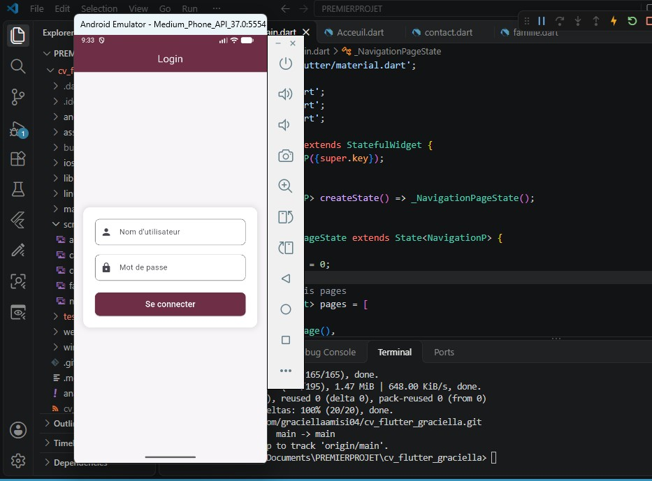
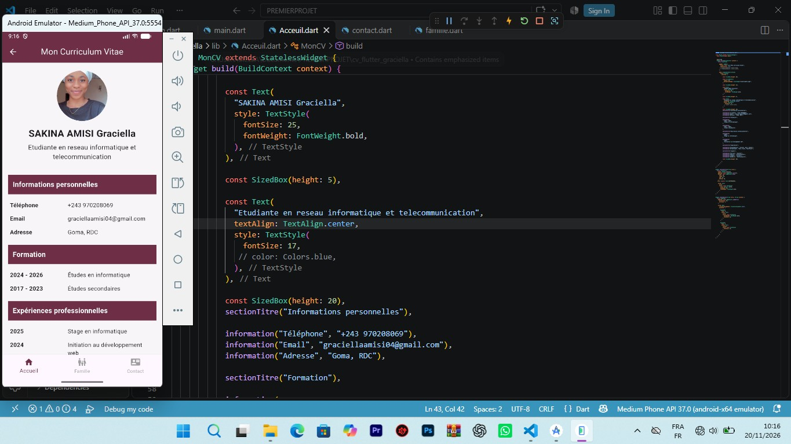
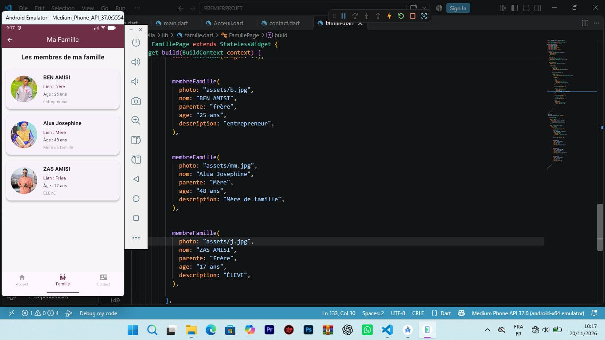
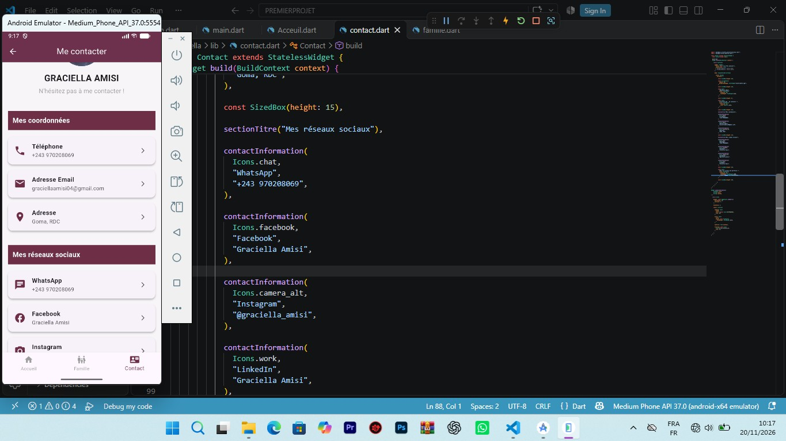
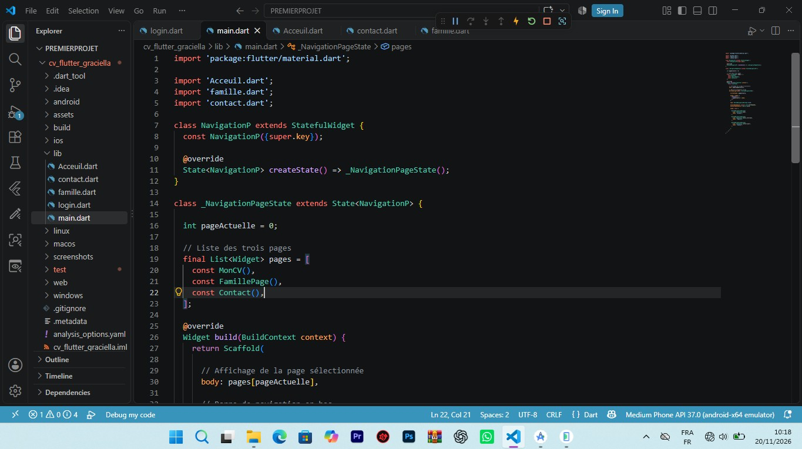
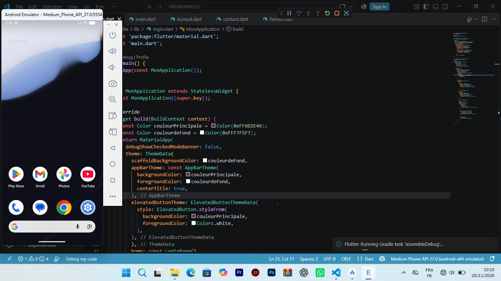

# cv_flutter_graciella

A new Flutter project.

## Getting Started
## Captures d'écran
### 1. Page de connexion

### 2. Page d'acceuil (CV)

### 3. Page famille

### 4. Page contact

### 5. Formulaire de navigation

## Vidéo de demo

Regarder la démonstration compète du TP2 : [Voir la vidéo sur google Drive](https://drive.google.com/file/d/1N9cTfpOnywB-G76Np11crrmFGHF7xYbY/view?usp=sharing)

This project is a starting point for a Flutter application.

A few resources to get you started if this is your first Flutter project:

- [Learn Flutter](https://docs.flutter.dev/get-started/learn-flutter)
- [Write your first Flutter app](https://docs.flutter.dev/get-started/codelab)
- [Flutter learning resources](https://docs.flutter.dev/reference/learning-resources)

For help getting started with Flutter development, view the
[online documentation](https://docs.flutter.dev/), which offers tutorials,
samples, guidance on mobile development, and a full API reference.
